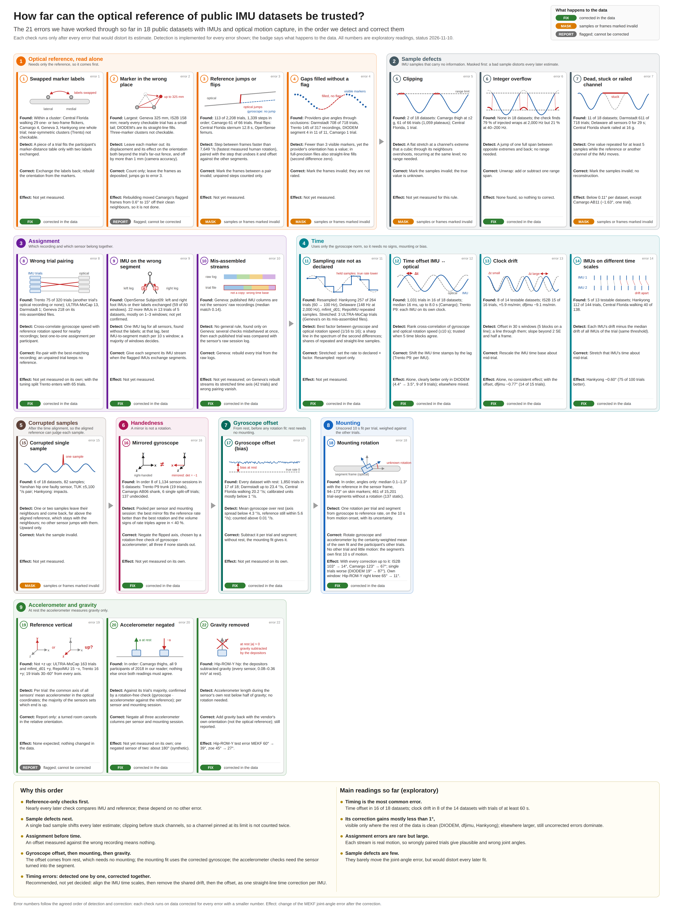
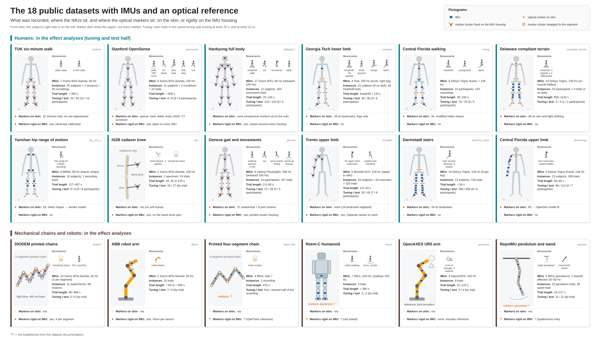

# mocapref: errors in public IMU datasets with an optical motion-capture reference

Code to detect and correct the errors found in 18 public datasets that record inertial sensors (IMUs) together
with an optical motion-capture reference, and to measure how the corrections change relative orientation (joint
angle) estimation with two state-of-the-art filters (MEKF and zoe).



## How to read this repository

```
images/                      visual abstract (errors in the order of correction) and dataset overview
splits/                      saved tuning/test split of every dataset (used by the effect analysis)
src/mocapref/
  recording.py               the common data model: Recording -> Segment -> ImuStream + ReferenceStream
  datasets/                  one loader per dataset; every loader returns the same Recording structure
  errors/                    one module per error, named by its number in the order of correction:
    e01_label_swaps.py ... e22_gravity_removed.py
                             each has check_for_<error>(recording), remove_<error>(...) and
                             handle_<error>(datasets) -> ErrorReport
    _report.py               ErrorReport: prevalence per dataset, per-trial rows, notes, corrected data
  correction.py              correct_in_order(): all errors corrected in the agreed order
  effect_analysis.py         EffectAnalysis: influence of the corrections on MEKF and/or zoe
  effect.py, zoe.py          the two estimators, tuning and scoring
  soft_tissue.py             soft-tissue motion between IMU and skin-marker segment frame (with main findings)
  motion_onset.py, tuning_split.py, rotations.py, resample.py, synthetic.py   helpers
tests/                       known-answer tests: for every error a synthetic recording with an injected
                             defect is recovered and a clean one is not flagged
```

Conventions: units are s, rad/s and m/s². Loaders never repair anything. A check returns `detected` True, False or
None (undecided); not detected is not absent. A correction returns a copy with a log entry
(`recording.corrections`) and marks samples it cannot repair invalid instead of inventing values.

## Setup

```bash
uv sync
uv run pytest -q          # about 5 minutes
```

The raw data are not part of the repository. The loaders read them from `/home/data/imu-orientation/raw/<dataset>/`
(`mocapref.datasets.base.DATA_ROOT`); every loader also accepts `root=...`. The ABB robot arm (`dfjimu`) and the printed four-segment chain (`mfimt_d01`)
are read from the folders named by the environment variables `MOCAPREF_DFJIMU` and `MOCAPREF_MFIMT` (default
`<DATA_ROOT>/dfjimu` and `<DATA_ROOT>/mfimt`); their loader tests are skipped when the data are not found.

## The datasets



Short names: `tuk6min`, `opensense`, `fullbody17`, `camargo`, `wmcg`, `compliant_terrain`, `hip_rom_y`, `is2b`,
`grouvel`, `bonfiglio`, `grimmer_stairs`, `ultramocap`, `diodem`, `dfjimu`, `mfimt_d01`, `reemc`, `openaxes`,
`repoimu` (the list is `mocapref.datasets.PAPER_DATASETS`). Two helper readers exist besides them: `grouvel_raw`
(Geneva with its IMU streams rebuilt from the raw session logs) and `bonfiglio_deposited` (Trento with the deposit's
own trial pairing).

### Load one or several datasets

```python
from mocapref.datasets import load_dataset, PAPER_DATASETS

loader = load_dataset('dfjimu')
print(loader.trials()[:3])
rec = loader.load(loader.trials()[0])
for name, seg in rec.segments.items():
    print(name, seg.imu.gyr.shape, seg.imu.rate_hz, len(seg.reference.orientation), seg.reference.rate_hz)
print(rec.joints, rec.participant, rec.session)

for name in ['is2b', 'hip_rom_y', 'camargo']:          # several datasets: the same structure for each
    loader = load_dataset(name)
    for rec in loader:                                  # every trial
        ...
```

## The errors

Numbered in the order in which they are detected and corrected: the check of error N runs on data already corrected
for every error with a smaller number, with one exception: gaps filled without a flag (4) are masked before reference
jumps or flips (3) are looked for, so the jump check runs on data corrected for errors 1, 2 and 4, and the gap check
on data corrected for errors 1 and 2 (`mocapref.correction.SEQUENCE`). *fix* = repaired, *mask* = samples or frames marked invalid,
*report* = flagged only.

| # | Error | Module | Data |
|---|---|---|---|
| 1 | Swapped marker labels (within a cluster) | `e01_label_swaps` | fix |
| 2 | Marker in the wrong place | `e02_misplaced_markers` | report |
| 3 | Reference jumps or flips | `e03_reference_jumps` | mask |
| 4 | Gaps filled without a flag | `e04_gap_fill` | mask |
| 5 | Clipping | `e05_clipping` | mask |
| 6 | Integer overflow | `e06_integer_overflow` | fix |
| 7 | Dead, stuck or railed channel | `e07_dead_channels` | mask |
| 8 | Wrong trial pairing | `e08_trial_pairing` | fix |
| 9 | IMU on the wrong segment | `e09_segment_assignment` | fix |
| 10 | Mis-assembled streams | `e10_mis_assembled_streams` | fix |
| 11 | Sampling rate not as declared | `e11_sampling_rate` | fix |
| 12 | Time offset between IMU and reference | `e12_time_offset` | fix |
| 13 | Clock drift between IMU and reference | `e13_clock_drift` | fix |
| 14 | IMUs of one trial on different time scales | `e14_time_scales` | report |
| 15 | Corrupted single samples | `e15_corrupted_samples` | mask |
| 16 | Mirrored gyroscope or single flipped axis | `e16_mirrored_gyroscope` | fix |
| 17 | Gyroscope offset | `e17_gyroscope_offset` | fix |
| 18 | Mounting rotation | `e18_mounting` | fix |
| 19 | Reference vertical not +z | `e19_e20_accelerometer_sign` | report |
| 20 | Accelerometer negated | `e19_e20_accelerometer_sign` | fix |
| 21 | Accelerometer bias | `e21_accelerometer_bias` | fix |
| 22 | Gravity removed from the accelerometer | `e22_gravity_removed` | fix |

Each module's docstring states the detection rule, the correction and its thresholds; its known-answer test is
`tests/test_eNN_<name>.py`.

### Handle a specific error

Every error has one function `handle_<error>(datasets, data=..., notes=..., processes=...)`. It works for any subset
of the datasets and returns an `ErrorReport`:

```python
from mocapref.errors import handle_time_offset

report = handle_time_offset(['dfjimu', 'is2b'], processes=8)   # data='deposited': the files as published
print(report)              # prevalence per dataset: trials checked, trials with the error, occurrences, undecided
report.prevalence          # the same as a table
report.rows                # one row per checked trial (or trial and segment), with the estimate
report.add_note('is2b', 'offset larger in the 120 s trials; check the trigger')   # notes on suspicious findings
fixed = report.corrected('is2b')          # a loader that returns the trials with this error corrected
rec = fixed.load(fixed.trials()[0])
print(rec.corrections)                    # what was changed
report.save('output')                     # prevalence.csv, rows.csv, notes.json
```

`data='in_order'` runs the check on data corrected for every earlier error (the prevalence in the order of
correction); `data='deposited'` on the published files (the independent prevalence, which also counts errors caused
by other errors). Notes can also be passed directly: `handle_clipping(['camargo'], notes={'camargo': '...'})`.

On a single recording, the check and the correction can be called directly:

```python
from mocapref import errors

result = errors.check_for_synchronisation_offset(rec)
print(result)                                   # detected or not, with the estimate in plain words
fixed = errors.remove_synchronisation_offset(rec, result)
```

### Correct all errors in the agreed order

```python
from mocapref.correction import correct_in_order, run_in_order, prevalence_table

loader = correct_in_order('camargo', cache_dir='output/cache')           # every handled error corrected
loader = correct_in_order('camargo', up_to=12, cache_dir='output/cache') # up to and including error 12
reports = run_in_order(['camargo', 'wmcg'], cache_dir='output/cache')     # {number: ErrorReport}
print(prevalence_table(reports))                                         # 'trials / occurrences' per error
```

Several corrections pool all trials of a participant or session, so each check runs over the whole dataset once;
with `cache_dir` the results are kept and later calls read them back.

## Influence on relative orientation estimation (MEKF, zoe or both)

```python
from mocapref.effect_analysis import EffectAnalysis

ea = EffectAnalysis(['dfjimu', 'is2b'], methods=('MEKF', 'zoe'), processes=8, cache_dir='output/cache')
summary = ea.run()        # per dataset and method: tuned R and Q, test error (median, mean) per condition
ea.tests                  # per test trial and joint: error in degrees per condition

EffectAnalysis('is2b', methods='MEKF').run()     # only the MEKF
EffectAnalysis('is2b', methods='zoe').run()      # only zoe
EffectAnalysis.for_error(18, ['is2b']).run()     # one error alone: corrected for 1-17 against 1-18
```

By default the conditions are the data as published (`deposited`) and the data with every handled error corrected
(`corrected`). For each dataset, condition and method, one parameter pair is tuned on the tuning half of the saved
split and the error is measured on the test half; scoring starts 10 s after the motion onset. The full procedure is
in the docstring of `effect_analysis.py`.

## Soft-tissue motion

Not one of the numbered errors, but a property of every skin-marker reference. `soft_tissue.py` measures how far an
IMU (its housing's marker cluster) and its skin-marker segment frame move against each other, in the three datasets
that carry both (TUK six-minute walk, Geneva gait, Hankyong full body), and the floor this sets for a joint angle.

```python
from mocapref.soft_tissue import segment_motion, joint_floor, summarize

segments, joints = summarize(segment_motion(processes=8), joint_floor(processes=8))
```

Main findings: the time-varying part is typically 1-5° per segment (median per trial) and 3-17° at the 95th
percentile, largest for the Geneva thigh and the Hankyong upper arm. The joint-level floor is 4.3° (TUK), 6.2°
(Geneva) and 4.9° (Hankyong) as the mean over a trial's joints, 6-8° for hip, knee and elbow in some datasets: an
IMU estimate cannot be expected to agree with a skin-marker reference better than this.
